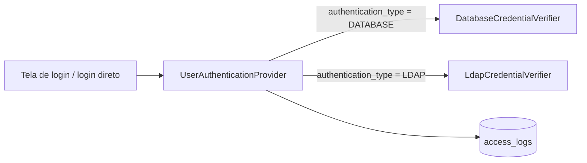

# Novo tipo de autenticação: LDAP

Este guia mostra como fazer o Sentry conferir a senha de um usuário no seu servidor LDAP. O mesmo roteiro vale para
qualquer outro tipo de autenticação: muda só a forma de conferir a senha.

## Como a autenticação está montada

O `sentry-auth` tem **um único** `AuthenticationProvider`, o `UserAuthenticationProvider`. Ele é usado pela tela de
login (PKCE) e pelo login direto, e cuida de tudo o que vale para qualquer tipo de usuário:

1. busca o sistema pelo `client_id` e o usuário pelo username, sem diferenciar maiúsculas;
2. pede ao **`CredentialVerifier` do `authentication_type` do usuário** que confira a senha;
3. confere se o usuário está ativo, se o sistema está disponível e se o usuário tem papel ativo nesse sistema;
4. grava **um** registro em `access_logs`, com o motivo real;
5. devolve a autenticação com o `uuid` do usuário, ou lança `BadCredentialsException` com a mensagem genérica.



O LDAP entra como um **novo `CredentialVerifier`**. Não é preciso mexer no provedor, no `LoginService` nem no
`SessionService`: o provedor recebe todos os beans `CredentialVerifier` e escolhe pelo `type()`.

> **Não crie outro `AuthenticationProvider`.** O `ProviderManager` tenta o próximo provedor a cada falha, então dois
> provedores gravariam dois registros por tentativa e nenhum dos dois saberia de quem é o `USER_NOT_FOUND`.

### O contrato

```java
public interface CredentialVerifier {
    AuthenticationType type();
    Verification verify(User user, String password);

    record Verification(boolean matches, Runnable onSuccess) {
        public static Verification accepted() { ... }
        public static Verification rejected() { ... }
    }
}
```

- `verify` recebe um usuário **que existe** no Sentry e é do seu `type()`. Usuário inexistente nunca chega ao verificador:
  o provedor confere a senha contra um hash falso (RN-F1-02.4).
- `verify` **não lança exceção de credencial**: senha errada é `Verification.rejected()`.
- `onSuccess` só roda quando a tentativa inteira tem sucesso, depois da checagem de usuário ativo, sistema e papel. O
  banco usa isso para gravar o re-hash. No LDAP, em geral, basta `Verification.accepted()`.

## O que o LDAP decide e o que o Sentry decide

| Pergunta | Quem responde |
| --- | --- |
| A senha confere? | **LDAP** (bind com o DN do usuário) |
| O usuário existe, está ativo, não foi excluído? | Sentry (tabela `users`) |
| Pode entrar neste sistema? | Sentry (papéis em `role_users`) |
| Qual o `sub` dos tokens? | Sentry (`users.uuid`) |

Ou seja: **o usuário LDAP precisa estar cadastrado no Sentry**, com `authentication_type = LDAP` e sem senha, e com
papéis nos sistemas em que pode entrar. Sem isso o login cai em `USER_NOT_FOUND` ou `NO_SYSTEM_ACCESS`. Bloquear o
usuário no LDAP também bloqueia o login, porque o bind falha.

---

## Passo 1 — Dependência

No `sentry-auth/pom.xml` (a versão vem do BOM do Spring Boot):

```xml
<dependency>
    <groupId>org.springframework.security</groupId>
    <artifactId>spring-security-ldap</artifactId>
</dependency>
```

Ela traz o `spring-ldap-core` e o `BindAuthenticator`, que faz o bind e já escapa o username no DN (evita *LDAP
injection*). Não monte o DN concatenando strings.

## Passo 2 — Configuração

Crie `sentry-auth/src/main/java/dev/sentry/auth/provider/ldap/LdapProperties.java`, no padrão do `BootstrapProperties`:

```java
package dev.sentry.auth.provider.ldap;

import org.springframework.boot.context.properties.ConfigurationProperties;
import org.springframework.boot.context.properties.bind.DefaultValue;

/**
 * Servidor LDAP que confere a senha dos usuários {@code LDAP} (RN-F1-02.7). Sem {@code url}, o LDAP fica desligado
 * e esses usuários recebem {@code INVALID_CREDENTIALS}.
 *
 * @param url endereço do servidor, ex.: {@code ldaps://ldap.exemplo.com:636}
 * @param base DN base, ex.: {@code dc=exemplo,dc=com}
 * @param userDnPattern DN do usuário relativo à base; {@code {0}} é o username
 */
@ConfigurationProperties("sentry.ldap")
public record LdapProperties(
        String url,
        String base,
        @DefaultValue("uid={0},ou=people") String userDnPattern) {
}
```

E no `sentry-auth/src/main/resources/application.yaml`, dentro de `sentry:`:

```yaml
  # LDAP que confere a senha dos usuários LDAP; sem url, fica desligado (RN-F1-02.7)
  ldap:
    url: ${SENTRY_LDAP_URL:}
    base: ${SENTRY_LDAP_BASE:}
    user-dn-pattern: ${SENTRY_LDAP_USER_DN_PATTERN:uid={0},ou=people}
```

Use `ldaps://` (ou StartTLS) em produção: a senha do usuário vai no bind.

Se o seu diretório não permite montar o DN pelo username (ex.: Active Directory com usuários em várias OUs), troque o
`userDnPattern` por uma busca: `FilterBasedLdapUserSearch` com um usuário de serviço, passado em
`BindAuthenticator.setUserSearch(...)`. O usuário e a senha de serviço também entram no `LdapProperties`, e o
`toString` deve esconder a senha (RN-F0-02.6), como no `BootstrapProperties`.

## Passo 3 — Os beans do LDAP

`sentry-auth/src/main/java/dev/sentry/auth/provider/ldap/LdapConfiguration.java`:

```java
package dev.sentry.auth.provider.ldap;

import org.springframework.boot.autoconfigure.condition.ConditionalOnExpression;
import org.springframework.boot.context.properties.EnableConfigurationProperties;
import org.springframework.context.annotation.Bean;
import org.springframework.context.annotation.Configuration;
import org.springframework.security.ldap.DefaultSpringSecurityContextSource;
import org.springframework.security.ldap.authentication.BindAuthenticator;
import org.springframework.security.ldap.authentication.LdapAuthenticator;

/** Liga o LDAP só quando {@code sentry.ldap.url} está preenchida. */
@Configuration
@EnableConfigurationProperties(LdapProperties.class)
@ConditionalOnExpression("!'${sentry.ldap.url:}'.isBlank()")
class LdapConfiguration {

    @Bean
    DefaultSpringSecurityContextSource ldapContextSource(LdapProperties properties) {
        return new DefaultSpringSecurityContextSource(properties.url() + "/" + properties.base());
    }

    @Bean
    LdapAuthenticator ldapAuthenticator(DefaultSpringSecurityContextSource contextSource, LdapProperties properties) {
        BindAuthenticator authenticator = new BindAuthenticator(contextSource);
        authenticator.setUserDnPatterns(new String[] {properties.userDnPattern()});
        return authenticator;
    }

    @Bean
    LdapCredentialVerifier ldapCredentialVerifier(LdapAuthenticator ldapAuthenticator) {
        return new LdapCredentialVerifier(ldapAuthenticator);
    }
}
```

Com a condição, o verificador só existe quando o LDAP está configurado. Sem ele, o provedor não acha verificador para
`LDAP` e responde `INVALID_CREDENTIALS`, gastando o mesmo hash falso de um usuário inexistente. É o comportamento de
hoje (CA-F1-02.5).

## Passo 4 — O `LdapCredentialVerifier`

`sentry-auth/src/main/java/dev/sentry/auth/provider/ldap/LdapCredentialVerifier.java`:

```java
package dev.sentry.auth.provider.ldap;

import dev.sentry.api.domain.user.User;
import dev.sentry.api.domain.user.User.AuthenticationType;
import dev.sentry.auth.provider.CredentialVerifier;
import org.slf4j.Logger;
import org.slf4j.LoggerFactory;
import org.springframework.security.authentication.UsernamePasswordAuthenticationToken;
import org.springframework.security.core.AuthenticationException;
import org.springframework.security.ldap.authentication.LdapAuthenticator;

/** Confere a senha de usuários {@code LDAP} com um bind no servidor LDAP (RN-F1-02.7). */
public class LdapCredentialVerifier implements CredentialVerifier {

    private static final Logger log = LoggerFactory.getLogger(LdapCredentialVerifier.class);

    private final LdapAuthenticator ldapAuthenticator;

    public LdapCredentialVerifier(LdapAuthenticator ldapAuthenticator) {
        this.ldapAuthenticator = ldapAuthenticator;
    }

    @Override
    public AuthenticationType type() {
        return AuthenticationType.LDAP;
    }

    /**
     * Faz o bind com o DN do usuário e a senha digitada. Senha vazia é recusada antes do bind, porque muitos
     * servidores aceitam bind sem senha como anônimo. Servidor fora do ar também recusa, sem derrubar o login.
     *
     * @param user usuário {@code LDAP}; o DN é montado com o username cadastrado no Sentry
     * @param password senha em claro
     * @return aceita quando o bind dá certo
     */
    @Override
    public Verification verify(User user, String password) {
        if (password == null || password.isEmpty()) {
            return Verification.rejected();
        }
        try {
            ldapAuthenticator.authenticate(
                    UsernamePasswordAuthenticationToken.unauthenticated(user.getUsername(), password));
            return Verification.accepted();
        } catch (AuthenticationException e) {
            return Verification.rejected();
        } catch (RuntimeException e) {
            // servidor fora do ar ou mal configurado: a tentativa ainda é registrada como INVALID_CREDENTIALS
            log.error("Falha ao consultar o LDAP para o usuário {}", user.getUsername(), e);
            return Verification.rejected();
        }
    }
}
```

Alguns pontos:

- **Use `user.getUsername()`, não o texto digitado.** O Sentry acha o usuário sem diferenciar maiúsculas, e o DN deve
  usar o username como foi cadastrado.
- **Pegue o `RuntimeException`.** Uma exceção que escapa do verificador derruba a requisição com `500` e a tentativa
  não é registrada em `access_logs`.
- **Não grave nada em `access_logs`** nem lance `BadCredentialsException`: isso é do provedor.
- Não registre a senha em log (RN-F0-02.6).

## Passo 5 — Cadastrar usuários LDAP

Hoje o `POST /users` exige `password` (`@NotBlank` em `UserRest.SaveRequest`) e o `UserService.save` sempre grava o
hash. Para usuários LDAP, isso precisa mudar:

- `password` obrigatório só quando `authenticationType` é `DATABASE` (validação no `UserService.save`, com mensagem em
  português, ex.: "Senha obrigatória para usuários DATABASE");
- usuário `LDAP` é gravado com `password = null`. Se vier uma senha, ela deve ser recusada ou ignorada, nunca gravada.

Pelas convenções do projeto, a alteração no `UserService` precisa de Javadoc e de testes no `UserServiceTest`.

Exemplo de cadastro depois da mudança:

```http
POST /users HTTP/1.1
Host: admin.exemplo.com
Content-Type: application/json

{"name": "Maria Silva", "authenticationType": "LDAP", "username": "maria.silva",
 "email": "maria@exemplo.com", "isActive": true}
```

Depois, dê a ela um papel no sistema em `role_users`, como para qualquer usuário.

## Passo 6 — Testes

**Unitário do verificador** (`LdapCredentialVerifierTest`), com o `LdapAuthenticator` mockado:

| Cenário | Esperado |
| --- | --- |
| bind dá certo | `matches() == true` |
| `authenticate` lança `BadCredentialsException` | `matches() == false` |
| `authenticate` lança uma `RuntimeException` qualquer (servidor fora) | `matches() == false`, sem propagar |
| senha `null` ou vazia | `matches() == false` e `authenticate` **nunca** chamado |
| username digitado com outra caixa | o bind usa `user.getUsername()` |
| `type()` | `AuthenticationType.LDAP` |

**No provedor**, o `UserAuthenticationProviderTest.passwordIsCheckedByTheVerifierOfTheUserType` já cobre a escolha do
verificador pelo tipo. Não é preciso repetir.

**Integração** (opcional): suba um OpenLDAP com Testcontainers (ex.: imagem `bitnami/openldap`) ou um servidor em
memória do UnboundID (`com.unboundid:unboundid-ldapsdk`, escopo `test`) com um LDIF de um usuário. Cadastre o mesmo
username no Sentry como `LDAP`, com papel em um sistema, e confira:

- senha certa → `SUCCESS` em `access_logs` e `sub` igual ao `uuid`;
- senha errada → `INVALID_CREDENTIALS`, mensagem "Usuário ou senha inválidos";
- usuário inativo no Sentry, com senha certa no LDAP → `USER_INACTIVE`.

## Cuidados

- **Tempo de resposta.** O bind no LDAP não leva o mesmo tempo que o Argon2id do hash falso de um usuário inexistente.
  Quem medir o tempo pode distinguir "usuário LDAP existe" de "não existe". Se isso importar no seu ambiente, iguale os
  tempos (ex.: um atraso mínimo no provedor) ou aceite o risco de forma consciente.
- **Disponibilidade.** Com o LDAP fora do ar, todo usuário LDAP recebe "Usuário ou senha inválidos". O motivo real
  fica só no log de erro do `sentry-auth`; `access_logs` mostra `INVALID_CREDENTIALS`.
- **TLS.** Sem `ldaps://` ou StartTLS, a senha trafega em claro até o servidor LDAP.
- **Tempo limite.** Configure *timeouts* de conexão e de leitura no `DefaultSpringSecurityContextSource` (propriedades
  `com.sun.jndi.ldap.connect.timeout` e `com.sun.jndi.ldap.read.timeout` em `setBaseEnvironmentProperties`), para um
  LDAP lento não segurar as threads do login.

## Checklist

- [ ] `spring-security-ldap` no `sentry-auth/pom.xml`
- [ ] `LdapProperties` e `sentry.ldap.*` no `application.yaml`
- [ ] `LdapConfiguration` condicionada a `sentry.ldap.url`
- [ ] `LdapCredentialVerifier` com `type() == LDAP`, sem lançar exceção
- [ ] `POST /users` aceitando usuário `LDAP` sem senha
- [ ] Testes unitários do verificador e do `UserService`
- [ ] `ldaps://` e *timeouts* configurados em produção
