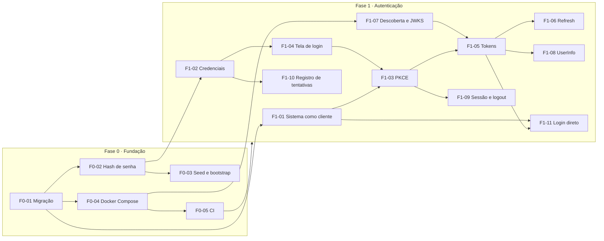
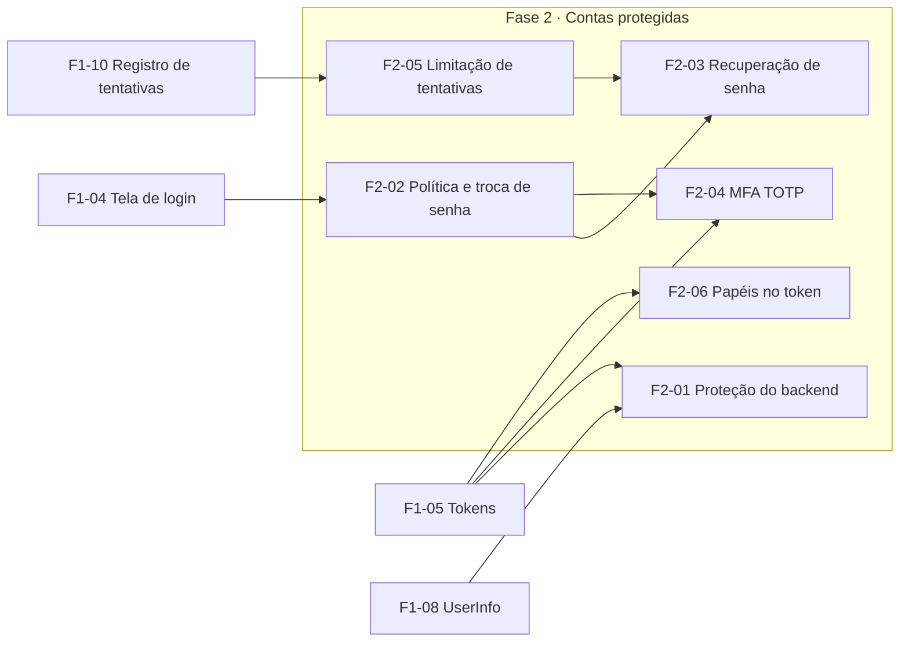

# Roadmap — sentry-auth, Fases 0 a 2

A Fase 0 deixa o projeto executável, seguro e testável; a Fase 1 entrega a autenticação de um usuário por um sistema externo, pelo fluxo PKCE e pelo login direto; a Fase 2 protege as contas (política de senha, recuperação, MFA, limitação de tentativas) e a administração. Cada tarefa abaixo fecha quando os critérios de aceite citados viram testes verdes na CI.

## Dependências

## Fase 0 — Fundação

**Critério de saída:** o branch `init` está no `main`, a CI está verde, e `docker compose up` sobe PostgreSQL, `sentry-auth` e `sentry-backend` com o administrador criado por variável de ambiente.

| # | Tarefa | Requisito | Critérios |
| --- | --- | --- | --- |
| 0.1 | Trocar a senha exposta no seed e substituir o seed por dados fictícios | F0-03 | CA-F0-03.4 |
| 0.2 | Corrigir o tipo de `role_actions.cd_action` na V1 e validar o esquema com Testcontainers | F0-01 | CA-F0-01.1 a .3 |
| 0.3 | (Opcional) Renomear a entidade `System` | F0-01 | — |
| 0.4 | `compose.yaml`, `Dockerfile` do `sentry-auth`, `.env.example` e health check | F0-04 | CA-F0-04.1 a .3 |
| 0.5 | Workflow do GitHub Actions: build, testes, Testcontainers, JaCoCo, gitleaks | F0-05 | CA-F0-05.1, .2 |
| 0.6 | Encoder Argon2id com prefixo no `sentry-api`, uso no `sentry-backend`, remoção de `salt` | F0-02 | CA-F0-02.1 a .4 |
| 0.7 | Bootstrap idempotente do administrador e do sistema `SENTRY` | F0-03 | CA-F0-03.1 a .3 |
| 0.8 | Publicar imagem no GHCR e proteger o `main` | F0-05 | CA-F0-05.3 |
| 0.9 | Integrar `init` ao `main` | F0-01 | Saída da fase |

## Fase 1 — Autenticação de usuário por sistema externo

**Critério de saída:** uma aplicação de exemplo, usando só uma biblioteca OIDC genérica, faz login via PKCE, renova o token, chama `/userinfo` e faz logout; e um sistema confiável faz login direto e recebe os mesmos tokens.

| # | Tarefa | Requisito | Critérios |
| --- | --- | --- | --- |
| 1.1 | Migração V2: colunas de cliente em `systems`, `system_redirect_uris`, colunas novas em `access_logs`, tabelas de autorização e de sessão | F1-01, F1-10, F1-03, F1-09 | — |
| 1.2 | CRUD dos dados de cliente e rotação de segredo no `sentry-backend` | F1-01 | CA-F1-01.1, .2, .4 |
| 1.3 | `DatabaseAuthenticationProvider` com regra de acesso ao sistema e tempo constante | F1-02 | CA-F1-02.1 a .5 |
| 1.4 | Gravação de `access_logs` e log estruturado | F1-10 | CA-F1-10.1 a .4 |
| 1.5 | Configurar o Authorization Server: `RegisteredClientRepository` sobre `systems`, chave de assinatura externa, descoberta e JWKS | F1-07, F1-01 | CA-F1-07.1 a .4, CA-F1-01.3 |
| 1.6 | Tela de login Thymeleaf com CSRF e cabeçalhos de segurança | F1-04 | CA-F1-04.1 a .4 |
| 1.7 | Fluxo `/oauth2/authorize` + `/oauth2/token` com PKCE obrigatório | F1-03 | CA-F1-03.1 a .5 |
| 1.8 | Customização dos claims do access token e do ID token | F1-05 | CA-F1-05.1 a .5 |
| 1.9 | Refresh token opaco com rotação, detecção de reuso e `/oauth2/revoke` | F1-06 | CA-F1-06.1 a .5 |
| 1.10 | `/userinfo` lendo do banco | F1-08 | CA-F1-08.1 a .3 |
| 1.11 | Sessão SSO em JDBC, `prompt=login` e `/connect/logout` | F1-09 | CA-F1-09.1 a .5 |
| 1.12 | `POST /api/v1/auth/login` para sistemas confiáveis, removendo o `LoginController` atual | F1-11 | CA-F1-11.1 a .6 |
| 1.13 | Aplicação de exemplo (SPA com `oidc-client-ts`) e teste ponta a ponta | F1-03 | CA-F1-03.6, saída da fase |
| 1.14 | Documentação: como cadastrar um sistema e integrar pelos dois caminhos | Todos | — |

As tarefas 1.3 e 1.4 podem andar em paralelo com 1.2 e 1.5; 1.12 só depende de 1.3, 1.5 e 1.8, e pode ser feita antes de 1.11.

## Fase 2 — Contas protegidas e administração segura

O `sentry-auth` é só API: as telas (login, troca e recuperação de senha, MFA) são do front-end em React, na mesma origem, que chama a API de sessão.

**Critério de saída:** a API de cadastro só responde ao `SENTRY.ADMIN` autenticado pelo próprio Sentry; um usuário define, troca e recupera a senha seguindo a política, ativa o TOTP e passa a entrar com dois fatores; tentativas repetidas são freadas; e um sistema recebe os papéis do usuário no token quando pede o escopo `roles`.

| # | Tarefa | Requisito | Critérios |
| --- | --- | --- | --- |
| 2.1 | Migração V5: `users.password_change_required` e `password_changed_at`; `password_tokens.token` com hash; `user_mfa`, `mfa_recovery_codes` e remoção de `mfa_tokens`; `systems.require_mfa`; índices de `access_logs` | F2-02, F2-03, F2-04, F2-05 | — |
| 2.2 | `sentry-backend` como resource server do `sentry-auth`, exigindo `SENTRY.ADMIN` pelo banco, com auditoria (`created_by`, `updated_by`, `isTrusted`) | F2-01 | CA-F2-01.1 a .6 |
| 2.3 | Bootstrap do sistema `SENTRY` como cliente público e Swagger UI do `sentry-backend` autenticado por PKCE | F2-01 | RN-F2-01.6, .7 |
| 2.4 | `PasswordPolicy` no `sentry-api` (8 a 128, lista de senhas comuns, sem composição) aplicada no cadastro e no bootstrap | F2-02 | CA-F2-02.1 a .3 |
| 2.5 | Troca obrigatória e voluntária de senha pela API de sessão (`POST /api/v1/session/password`), revogando sessões e refresh tokens; bloqueio no login direto | F2-02 | CA-F2-02.4 a .6 |
| 2.6 | Limitação por conta e por IP a partir de `access_logs`, com bloqueio progressivo e desbloqueio pelo administrador | F2-05 | CA-F2-05.1 a .5 |
| 2.7 | Recuperação de senha por API (`/api/v1/password/forgot`, `/reset/validate`, `/reset`) com token em hash e link para `SENTRY_FRONTEND_URL/reset`, SMTP configurável e Mailpit no Compose | F2-03 | CA-F2-03.1 a .6 |
| 2.8 | Cadastro do TOTP pela API de sessão (`/mfa/setup` devolve o URI `otpauth://`, `/mfa/confirm`), segredo cifrado, códigos de recuperação | F2-04 | CA-F2-04.5 |
| 2.9 | Segundo fator no login pela API de sessão (`mfaRequired`, `POST /api/v1/session/mfa`) e no login direto, `amr`, `acr_values`, `require_mfa` e desativação pelo administrador | F2-04 | CA-F2-04.1 a .4, .6, .7 |
| 2.10 | Escopo `roles`: papéis do sistema no access token e no `/userinfo` | F2-06 | CA-F2-06.1 a .4 |
| 2.11 | Documentação: administração pela API, MFA, recuperação e papéis no token | Todos | — |

A 2.1 vem antes de tudo. Depois dela, 2.2 e 2.3 (backend) andam em paralelo com 2.4 a 2.6 (senha e limites) e com 2.10 (papéis); a 2.7 depende da 2.4 e da 2.6, e a 2.9 depende da 2.8 e da 2.6.

### Fora da Fase 2

- Login via LDAP e login social.
- Multi-tenant completo e administradores por organização.
- Back-channel logout (avisar os outros sistemas no logout).
- Passkeys (WebAuthn), CAPTCHA e lembrar o aparelho no MFA.
- Ações no token, introspecção (RFC 7662) e o serviço `sentry-authorization`.
- Console de administração (front-end).

## Decisões pendentes que afetam o roadmap

Cada arquivo tem uma seção **Questões em aberto**. As que mudam o plano:

- F1-02: exigir papel no sistema para autenticar (muda a tarefa 1.3).
- F1-01: `client_id` = `external_code` ou `uuid` (muda a migração 1.1).
- F0-04: incluir o `sentry-backend` no Compose (muda a tarefa 0.4).
- F2-01: validar o papel `SENTRY.ADMIN` pelo banco ou por claim (muda a tarefa 2.2).
- F2-04: remover a tabela `mfa_tokens` (muda a migração 2.1).
- F2-05: contar falhas por conta ou por conta + IP (muda a tarefa 2.6).
